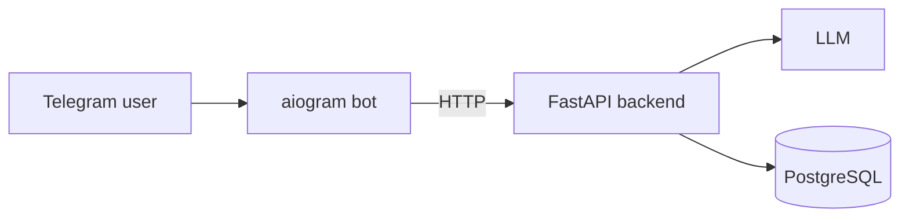

# Multilingual AI Doctor — Telegram Bot

> A multilingual AI health assistant on Telegram. An aiogram front end talks to a FastAPI backend that runs the medical dialogue model and stores history in PostgreSQL.


## Features

- Multilingual conversation (Uzbek, Russian, English).
- Conversation history stored per user.
- Separate bot and backend services.
- FastAPI backend reusable from other clients.

## Tech Stack

| Layer | Technology |
|---|---|
| Bot | aiogram |
| Backend | FastAPI |
| LLM | Gemini / Groq |
| Database | PostgreSQL, SQLAlchemy |
| Packaging | uv (pyproject.toml) |

## Architecture



## Quick Start

```bash
git clone https://github.com/dastonbek8747/multilingual-ai-doctor-telegram-bot.git
cd multilingual-ai-doctor-telegram-bot
cp .env.example .env      # add BOT_TOKEN, LLM key, DATABASE_URL
pip install -r requirements.txt

# terminal 1
uvicorn backend.main:app --reload

# terminal 2
python Bot/main.py
```

## Environment variables

| Variable | Meaning |
|---|---|
| `BOT_TOKEN` | Telegram bot token. |
| `DATABASE_URL` | PostgreSQL connection string. |
| `GEMINI_API_KEY` | LLM API key. |

## Disclaimer

This bot gives general information only. It is not a medical device and does not replace a doctor.

## License

MIT © 2026 Doston Sultonov.
